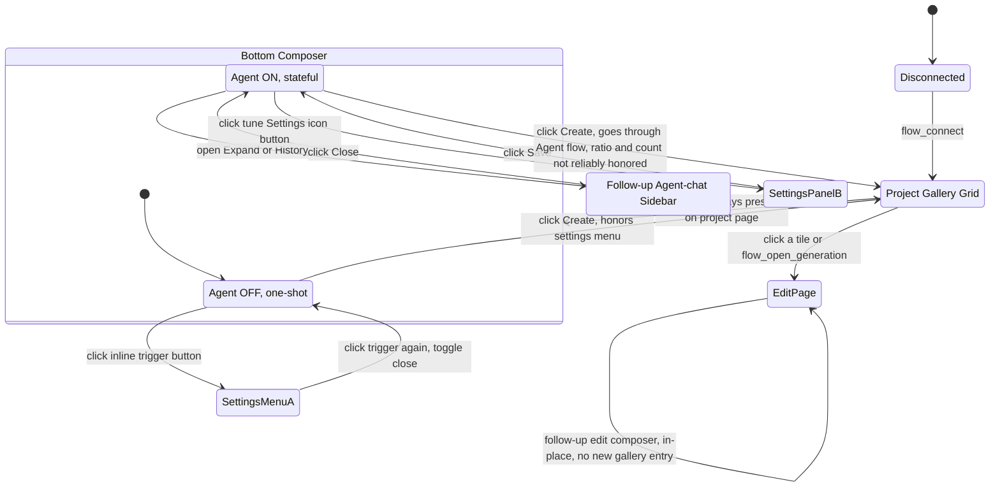

# Google Flow UI state machine

Every automation bug found this session traced back to one root cause: not knowing which of Flow's UI states the browser was actually in before acting. This document is the ground truth, confirmed live (real Playwright/CDP clicks against the running app, not guesswork) — not derived from reading Flow's source.

## The states

- Agent-OFF settings-menu inline trigger button shows current state directly: banana emoji, model name, ratio icon, quantity (e.g. `xN`).
- Agent-ON `SettingsPanelB` is the one this session's code has driven so far — confirmed unreliable for controlling actual generation output.

## Composer mode: fresh vs. follow-up sidebar

- **Fresh** — the plain bottom composer on the project page. Always present.
- **Follow-up sidebar** — a separate, stateful, per-project panel (History / New session / Close), opened by expanding an Agent-mode conversation or clicking History. It has its own composer (placeholder `"What do you want to change?"` for edit pages, or the full conversation composer for the sidebar) — structurally the same Slate widget as the fresh composer, which is why naive selectors can silently land in the wrong one.
- Detected via `isSidebarOpen`/closed via `closeSidebar` in `src/browser/agent-settings.js`. Forced closed before every `flow_generate_image`/`flow_generate_video` call.

## Agent toggle: OFF (one-shot) vs. ON (stateful) — **the new finding**

Independent of sidebar/fresh, the bottom composer has an **Agent toggle button** (`<button aria-pressed="true|false">Agent</button>`) that was not previously tracked. It changes both the settings-entry UI *and*, apparently, whether per-call settings are actually honored by generation:

| | Agent OFF (one-shot) | Agent ON (stateful) |
|---|---|---|
| Settings trigger | Inline button showing current state directly: `🍌 Nano Banana Pro [ratio icon] xN` | Separate icon-only "tune Settings" button (no inline state) |
| Settings surface | Radix `role="menu"` dropdown (11 `role="tab"` elements: 2 mode + 5 ratio + 4 quantity, plus a model sub-dropdown) | Panel/dialog with a **Save** button |
| Apply mechanism | **Live** — clicking a tab applies immediately, confirmed via a real click (16:9 tab went `aria-selected=true`, trigger button text updated to the ratio icon) | Requires clicking Save (already implemented in `agent-settings.js`) |
| Close mechanism | Click the trigger button again (toggle). **Do not click elsewhere to dismiss** — confirmed live that an outside click can land on a gallery tile underneath and navigate away instead of just closing the menu. | Click Save (already implemented) |
| Generation reliability | Ratio/model/count are honored per the menu's current state (this is the standard one-shot generate flow) | Generation routes through the Agent's own conversational tool-calling — **this session repeatedly observed 16:9 × 2 output regardless of what the tune-panel showed**, i.e. the panel's settings are not reliably what actually gets sent |
| Credit note | Menu footer literally states `Generating will use 0 credits` before commit | Not shown the same way |

**Important gotcha confirmed live:** a synthetic `element.click()` (raw JS DOM method) does **not** register with these Radix tabs — the click was accepted (no error) but `aria-selected` never changed. Only a real trusted click (Playwright `locator.click()` / actual mouse event) works. This is consistent with why the MCP has used Playwright's `.click()` throughout rather than `page.evaluate(() => el.click())`.

### Why this matters

The whole session's recurring "why did it generate 2 images at 16:9 no matter what we set" bug is very likely explained by this: `agent-settings.js`'s `ensureSettingsPanelOpen` only ever looks for the icon-only `tune Settings` button — which **only exists when Agent mode is ON**. So every `applySettings` call this session was reading/writing the Agent-ON settings panel, which — per the table above — is the one variant whose settings aren't reliably honored by the actual generation.

## The recommended default (not yet implemented)

Force **Agent OFF** before applying settings or generating, same way `closeSidebar` forces the sidebar closed — i.e. a third mode-normalization step, in addition to the existing sidebar check:

1. `closeSidebar(page)` — existing, unchanged.
2. **New:** `ensureAgentOff(page)` — read the Agent toggle's `aria-pressed`; if `"true"`, click it to turn it off.
3. Settings entry point becomes the inline trigger button, not the tune icon — `ensureSettingsPanelOpen`/`applySettings` need an Agent-OFF code path (Radix menu semantics: live-apply per tab, close by re-clicking the trigger, never click elsewhere to dismiss).

This should become the MCP's default generation path. Agent-ON stateful mode (useful for genuine multi-turn conversational edits — "in the last image, change this and that" — where Flow's own agent tracks conversation state across turns) is a deliberately separate, more complex mode: it would need its own session/state concept in the MCP rather than the current one-job-per-call model, and is explicitly deferred, not designed here.

## Open questions to resolve before implementing `ensureAgentOff`

- Does the edit page's (`/edit/{id}`) follow-up composer have its own Agent toggle, or does it always behave like one-shot? Not yet checked live.
- Does the Agent-OFF settings menu's live-apply behavior hold for the model sub-dropdown the same way it did for ratio tabs (confirmed) and quantity tabs (not yet individually confirmed, though same `role="tab"` structure)?
- Should `flow_change_settings` (used standalone, outside a generate call) also force Agent OFF, or only the generate/edit tools?
